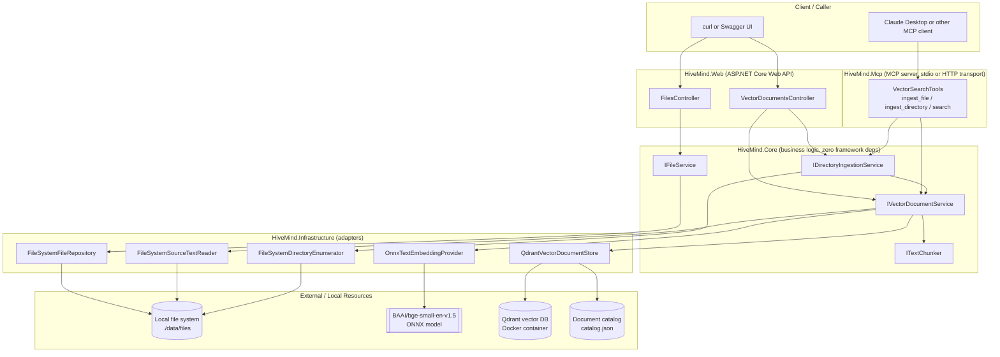

# HiveMind API

A small, clean-architecture ASP.NET Core solution for three related jobs:

1. **Vector search** — teams can ingest a single file or an entire folder of
   files into a local [Qdrant](https://qdrant.tech/) vector index, using a
   free local embedding model, and then run semantic search over that shared
   knowledge from any client.
2. **MCP server** — an AI assistant such as Claude Desktop can call the same
   ingest and search operations directly as [Model Context Protocol](https://modelcontextprotocol.io)
   tools, over stdio or the remote Streamable HTTP transport.

## Purpose

- **Shared team knowledge.** A team points the API at a shared folder (a
  checked-out docs repo, a shared drive mount, meeting-notes exports, etc.)
  and ingests it into one named vector index. Any team member who knows that
  index name can then semantically search across everyone's ingested content
  without standing up their own embedding or vector-database infrastructure.
- **A case study for building an MCP server.** This project is built with a
  small, well-tested Core layer (`IFileService`, `IVectorDocumentService`,
  `IDirectoryIngestionService`) sitting behind two thin, interchangeable front
  ends: an HTTP API (`HiveMind.Web`) and an MCP server (`HiveMind.Mcp`). Both
  front ends call the exact same Core services, so ingestion and search
  behavior is identical whether the caller is `curl`, Swagger UI, or an AI
  agent talking MCP — no business logic is duplicated between them. See
  [MCP server](#mcp-server) below for how it's wired up and how to connect
  Claude Desktop to it.

## Key features

- **Single-file semantic ingestion**: read a permitted local text file, chunk
  it, embed each chunk with a free local ONNX model, and upsert it into a
  named Qdrant collection.
- **Whole-folder ingestion**: ingest every supported file directly under a
  folder (optionally recursive) into one named index in a single request,
  with a per-file `Ingested` / `Skipped` / `Failed` report so nothing silently
  disappears.
- **Semantic search**: embed a natural-language query and return the top-`N`
  most similar chunks, each with the source file name, path, character
  offsets, and similarity score.
- **Local-only embeddings**: uses the free `BAAI/bge-small-en-v1.5` ONNX
  model — no file content or query text ever leaves the machine to a hosted
  embedding API.
- **Safe by construction**: every source path (file or directory) is
  resolved and validated against a configured allowed root, rejecting path
  traversal outside it.
- **Re-ingestion is idempotent by content**: re-ingesting an unchanged file is
  a no-op (matched by content hash); a changed file is atomically replaced
  (new version upserted and marked active before the old version is removed).
- **Swagger / OpenAPI** UI for exploring and trying every HTTP endpoint.
- **MCP tools for the same vector search use cases**: `search`, `list_indexes`, `inspect_index_schema`,
  `create_index`, and `store_memory` are exposed over stdio or Streamable HTTP
  via `HiveMind.Mcp`, so an MCP-compatible AI client can inspect payload fields,
  create task-specific indexes, ingest, search, and store its own memories
  (notes, code snippets, preferences, task progress) in the shared knowledge
  base as naturally as a human calling the REST API.
- **CLI for updating the vector database**: `HiveMind.Cli` provides
  `ingest-file` and `ingest-directory` commands for scripting or ad hoc
  ingestion straight from a terminal, using the same Core services as the
  Web API and MCP server.

## Architecture overview

The solution follows the Clean Architecture rules in
[specs/cleanArchitecture.md](./specs/cleanArchitecture.md): dependencies point
inward, Core defines abstractions, Infrastructure implements them, and Web is
a thin orchestration and HTTP layer.



### Vital services

| Service | Layer | Responsibility |
|---|---|---|
| `IFileService` / `FileService` | Core | Add, update, delete, get, and list files; validates names and size limits; returns `AppResult`. |
| `IFileRepository` / `FileSystemFileRepository` | Infrastructure | Reads and writes file bytes under the configured root, rejecting path traversal. |
| `IVectorDocumentService` / `VectorDocumentService` | Core | Orchestrates single-file ingest (read → chunk → embed → store) and search; owns all validation. |
| `IDirectoryIngestionService` / `DirectoryIngestionService` | Core | Enumerates a folder, ingests each discovered file through `IVectorDocumentService`, and aggregates a per-file report. Never duplicates single-file logic. |
| `ISourceTextReader` / `FileSystemSourceTextReader` | Infrastructure | Resolves, validates, size-checks, decodes, and hashes a source file. |
| `IDirectoryFileEnumerator` / `FileSystemDirectoryEnumerator` | Infrastructure | Resolves a directory path against the allowed root and lists candidate files (optionally recursive), enforcing the max-files-per-batch limit. |
| `ITextChunker` / `TextChunker` | Core | Splits text into overlapping character-offset chunks for embedding. |
| `ITextEmbeddingProvider` / `OnnxTextEmbeddingProvider` | Infrastructure | Tokenizes text and runs the local ONNX model to produce normalized embedding vectors. |
| `IVectorDocumentStore` / `QdrantVectorDocumentStore` | Infrastructure | Creates/validates Qdrant collections, upserts and activates new versions, retires old versions, and runs similarity search. |
| `VectorSearchTools` (`HiveMind.Mcp`) | Web (MCP front end) | Static `[McpServerTool]` methods (`search`, `list_indexes`, `inspect_index_schema`, `create_index`, `store_memory`) that call straight into `IVectorDocumentService` / `IDirectoryIngestionService` and serialize the `AppResult` as JSON for the calling MCP client. |

## Getting started

Requires the **.NET 10 SDK**, **Docker** (for Qdrant), and Python/`pip` (to
download the embedding model once).

### 1. Clone and restore

```bash
git clone <this-repo-url>
cd hivemind
cd src/HiveMind.Mcp
dotnet build
```

### 2. Download the local embedding model (one-time)

Navigate to the root of the repository.

```bash
python -m venv .venv
source .venv/bin/activate

pip install -U huggingface_hub
hf download Xenova/bge-small-en-v1.5 --local-dir ./models/bge-small-en-v1.5-onnx
```

The `VectorSearch:ModelDirectory` setting must point at the folder containing
`model.onnx` and `vocab.txt` (defaults to
`./models/bge-small-en-v1.5-onnx/onnx` relative to `src/HiveMind.Web`).

Update the ModelDirectory for the following appsettings.json
- src/HiveMind.Mcp/appsettings.json
- src/HiveMind.Cli/appsettings.json
- src/HiveMind.Web/appsettings.json

### 3. Start local Qdrant

```bash
export QDRANT_API_KEY=local-development-secret
docker compose -f docker-compose/qdrant/docker-compose.yaml up -d
```

Qdrant's REST/Web UI is on `http://localhost:6333` and gRPC is on `6334`.

### 4. Run the API

```bash
dotnet run --project src/HiveMind.Web
```

Swagger UI is available at `/swagger` (enabled by default in Development, or
via the `Swagger:Enabled` setting). Files are stored under
`./data/files` by default.


## Vector search

Vector search indexes supported local text files into a caller-specified Qdrant
index (a Qdrant collection) and searches only the index supplied in the
request. The API uses the free, local `BAAI/bge-small-en-v1.5` ONNX model; it
does not send file content or queries to a hosted embedding service.

The source path (file or directory) must be beneath `VectorSearch:AllowedSourceRoot`
(default: `./data/files`) and have a configured text extension.
`vectorIndexName` is required on every request and must match
`^[a-z0-9][a-z0-9_-]{0,62}$`; it maps one-to-one to a Qdrant collection.


## MCP server

`HiveMind.Mcp` exposes the vector search use cases as [Model Context
Protocol](https://modelcontextprotocol.io) tools over **stdio** or the
Streamable **HTTP** transport, built with the official
[MCP C# SDK](https://www.nuget.org/packages/ModelContextProtocol) following
the pattern in
[Build a Model Context Protocol (MCP) server in C#](https://devblogs.microsoft.com/dotnet/build-a-model-context-protocol-mcp-server-in-csharp/).
It is a thin, standalone console host: it calls the exact same
`IVectorDocumentService` and `IDirectoryIngestionService` used by
`VectorDocumentsController`, so an AI assistant gets identical ingestion and
search behavior to the HTTP API, against the same Qdrant index, model, and
document catalog.

The stdio transport is intended for a trusted local MCP client. The HTTP
transport requires a shared API key configured by the server administrator;
every client with that key has access to the same tools and data.

### Available tools

| Tool | Maps to | Description |
|---|---|---|
| `search` | `IVectorDocumentService.SearchAsync` | Finds the top-`N` semantically similar chunks in a named vector index for a natural-language query. |
| `list_indexes` | `IVectorDocumentService.ListIndexesAsync` | Lists the vector indexes (Qdrant collections) available in the instance, with vector size, distance metric, point count, and compatibility with this server's embedding model. |
| `inspect_index_schema` | `IVectorDocumentService.InspectIndexSchemaAsync` | Reports payload schema fields and types, indexed fields, point count, vector count, and status for a collection; returns not-found for a missing collection. |
| `create_index` | `IVectorDocumentService.CreateIndexAsync` | Creates an empty task-specific vector index using this server's embedding dimensions and Cosine distance; returns conflict if the name already exists. |
| `store_memory` | `IVectorDocumentService.StoreMemoryAsync` | Stores text (notes, code snippets, user preferences, task progress) as agent memory in a named vector index, with optional `tags`, `author`, `sourceUrl`, and an idempotent `key` for updating an existing memory in place. Creates the index automatically if it doesn't exist. |

Each tool returns a JSON string: `{"success":true,"data":{...}}` on success,
or `{"success":false,"status":"Invalid","messages":[...],"validationErrors":[...]}`
on failure — mirroring the same `AppResult` outcomes the HTTP API maps to
status codes, just without the HTTP layer.

### Run it standalone (for testing)

The default transport is stdio, so it's normally launched by an MCP client
rather than run interactively. To confirm it starts correctly:

```bash
dotnet build src/HiveMind.Mcp/HiveMind.Mcp.csproj
dotnet run --project src/HiveMind.Mcp
```

It will sit waiting for JSON-RPC messages on stdin; press `Ctrl+C` to stop it.
Make sure Qdrant is running and the embedding model is downloaded first (see
[Getting started](#getting-started)) — the tools call the same
`VectorSearch` configuration described below.

By default, `src/HiveMind.Mcp/appsettings.json` points its
`VectorSearch:AllowedSourceRoot`, `ModelDirectory`, and `CatalogPath` at the
sibling `HiveMind.Web` project's `data/` and `models/` folders, so both the
Web API and the MCP server read and write the **same** files, index, and
catalog. Override any of these with environment variables (for example
`VectorSearch__AllowedSourceRoot`) if you want the MCP server to point
somewhere else.

### Run as a remote HTTP MCP server

Set `Mcp:Transport` to `http` (or use the equivalent
`Mcp__Transport=http` environment variable) to expose the same tools through
the SDK's Streamable HTTP endpoint. HTTP startup requires a non-empty
administrator-configured API key. Set `Mcp:ApiKey` through a secret provider or
the `Mcp__ApiKey` environment variable; never commit the value to
`appsettings.json` or pass it on a command line. Every request to the MCP
endpoint, including initialization and tool calls, must include that value in
the `X-API-Key` header.

The default endpoint is `/mcp`; override it with `Mcp:HttpPath` or
`Mcp__HttpPath`. Configure the listen address with the normal ASP.NET Core
`ASPNETCORE_URLS` setting:

```bash
export Mcp__ApiKey="your-generated-secret"
MCP_HTTP_HOST=127.0.0.1 ./scripts/start-mcp-http.sh
```

An MCP client can connect to `http://localhost:5080/mcp` and must attach the
header on all MCP HTTP requests. For clients that support custom HTTP headers,
the remote-server configuration is conceptually:

```json
{
  "url": "https://your-mcp-host.example/mcp",
  "headers": {
    "X-API-Key": "the-same-secret-configured-on-the-server"
  }
}
```

Client configuration formats vary; configure the URL and custom header using
the client-specific settings. Use HTTPS whenever traffic leaves the local
machine or crosses an untrusted network, typically with TLS terminated by a
trusted reverse proxy. The launcher binds to all interfaces by default, so
configure the key and protect network traffic before exposing it. Stdio
remains unchanged and does not require an API key.

The repository also includes a launcher script that binds to all interfaces,
which is useful when exposing the server through a GitHub Codespaces forwarded
port:

```bash
./scripts/start-mcp-http.sh
```

Set `MCP_HTTP_HOST` and `MCP_HTTP_PORT` to override the defaults
(`0.0.0.0:5080`). Set `Mcp__ApiKey` before launching; the script exits without
starting if it is missing. It does not print or forward the key as a command
line argument.

### Connect Claude Desktop

1. Build the project once so `dotnet run` doesn't need to rebuild on every
   launch:

   ```bash
   dotnet build src/HiveMind.Mcp/HiveMind.Mcp.csproj
   ```

2. Open Claude Desktop → **Settings → Developer → Edit Config**. This opens
   `claude_desktop_config.json`:
   - macOS: `~/Library/Application Support/Claude/claude_desktop_config.json`
   - Windows: `%APPDATA%\Claude\claude_desktop_config.json`

3. Add an entry under `mcpServers` that runs the project with `dotnet run`,
   using the **absolute path** to `HiveMind.Mcp.csproj` on your machine:

   ```json
   {
     "mcpServers": {
       "filerepo-vector-search": {
         "command": "dotnet",
         "args": [
           "run",
           "--project",
           "/absolute/path/to/hivemind/src/HiveMind.Mcp/HiveMind.Mcp.csproj"
         ]
       }
     }
   }
   ```

   On Windows, use a Windows-style absolute path (e.g.
   `"D:\\source\\hivemind\\src\\HiveMind.Mcp\\HiveMind.Mcp.csproj"`).

4. Make sure Qdrant is running (`docker compose -f docker-compose/qdrant/docker-compose.yaml up -d`)
   and the embedding model has been downloaded, since Claude Desktop starts
   the server for you — it won't start Qdrant or download the model itself.

5. Restart Claude Desktop. Open a conversation, click the tools/hammer icon,
   and confirm `ingest_file`, `ingest_directory`, and `search` are listed
   under the `filerepo-vector-search` server.

6. Try it, for example:

   > Use the ingest_directory tool to ingest ./data/files into the
   > vector index "docs_v1", then use the search tool to find anything
   > about "dependency inversion" in that index.

   Claude will ask for your approval before calling each tool, same as any
   other MCP tool call.

### Connect GitHub Copilot (VS Code)

VS Code's Copilot Chat can also launch and use this MCP server in **Agent
mode**.

1. Build the project once so `dotnet run` doesn't need to rebuild on every
   launch:

   ```bash
   dotnet build src/HiveMind.Mcp/HiveMind.Mcp.csproj
   ```

2. In the repository root, create (or open) `.vscode/mcp.json` and add a
   server entry. Because the config is relative to the workspace, you can use
   a workspace-relative path here instead of an absolute one:

   ```json
   {
     "servers": {
       "filerepo-vector-search": {
         "type": "stdio",
         "command": "dotnet",
         "args": [
           "run",
           "--project",
           "${workspaceFolder}/src/HiveMind.Mcp/HiveMind.Mcp.csproj"
         ]
       }
     }
   }
   ```

   Alternatively, run **Command Palette → MCP: Add Server…** and choose
   **Command (stdio)**, supplying `dotnet` as the command and
   `run --project ${workspaceFolder}/src/HiveMind.Mcp/HiveMind.Mcp.csproj` as
   the arguments; VS Code will write the same `.vscode/mcp.json` for you.

3. Make sure Qdrant is running
   (`docker compose -f docker-compose/qdrant/docker-compose.yaml up -d`) and
   the embedding model has been downloaded — VS Code starts the server
   process for you but won't start Qdrant or download the model.

4. Open the Command Palette and run **MCP: List Servers** to confirm
   `filerepo-vector-search` shows as running, or open Copilot Chat, switch to
   **Agent** mode, and click the tools icon to confirm `ingest_file`,
   `ingest_directory`, and `search` are listed.

5. Try it in Agent mode, for example:

   > Use the ingest_directory tool to ingest ./data/files into the
   > vector index "docs_v1", then use the search tool to find anything
   > about "dependency inversion" in that index.

   Copilot will prompt for confirmation before invoking each tool, the same
   as it does for any other MCP tool call.

## CLI tool

`HiveMind.Cli` is a small standalone console app for ingesting content into
the vector database from the command line, without going through the HTTP
API or an MCP client. Like `HiveMind.Mcp`, it's a thin host that calls the
same `IVectorDocumentService` and `IDirectoryIngestionService` used
everywhere else, so ingestion behaves identically no matter which front end
started it.

Build it once, then invoke the compiled executable (or use `dotnet run` in
development):

```bash
dotnet build src/HiveMind.Cli/HiveMind.Cli.csproj

# Ingest a single file
dotnet run --project src/HiveMind.Cli -- ingest-file --index docs_v1 --path ./data/files/notes.md

# Ingest every supported file directly under a folder
dotnet run --project src/HiveMind.Cli -- ingest-directory --index docs_v1 --path ./data/files

# ...including subdirectories
dotnet run --project src/HiveMind.Cli -- ingest-directory --index docs_v1 --path ./data/files --recursive
```

| Command | Maps to | Description |
|---|---|---|
| `ingest-file` | `IVectorDocumentService.IngestAsync` | Indexes a single permitted local text file into a named vector index. |
| `ingest-directory` | `IDirectoryIngestionService.IngestDirectoryAsync` | Indexes every supported file under a permitted local directory (add `--recursive` to include subdirectories) into a named vector index, reporting each file as `Ingested`, `Skipped`, or `Failed`. |

Both commands require `--index` (`-i`, the Qdrant collection name) and
`--path` (`-p`, the file or directory to ingest), and print the resulting
`AppResult` as JSON to stdout — `{"success":true,"data":{...}}` on success,
or `{"success":false,"status":"Invalid","messages":[...],"validationErrors":[...]}`
on failure — with a non-zero exit code on failure so it's easy to script.
Run `dotnet run --project src/HiveMind.Cli -- --help` for the full usage.

Make sure Qdrant is running and the embedding model is downloaded first (see
[Getting started](#getting-started)). `src/HiveMind.Cli/appsettings.json`
has its own `VectorSearch` section, defaulted (like `HiveMind.Mcp`) to point
at the sibling `HiveMind.Web` project's `data/` and `models/` folders via
relative `../HiveMind.Web/...` paths, so all three processes share the same
allowed root, model, and catalog. Override it with `Section__Key`
environment variables, or by appending extra arguments (for example
`--VectorSearch:QdrantEndpoint http://localhost:6333`).

## Configuration

All settings live in `src/HiveMind.Web/appsettings.json` and can be
overridden with environment variables using the `Section__Key` convention
(for example `VectorSearch__QdrantApiKey`).

| Section | Key | Default | Purpose |
|---|---|---|---|
| `FileRepository` | `RootPath` | `./data/files` | Root folder for the file repository (add/update/delete/get/list). |
| `FileRepository` | `MaxFileSizeBytes` | `10485760` | Maximum upload size for `/api/files/add` and `/update`. |
| `VectorSearch` | `AllowedSourceRoot` | `./data/files` | Root folder that both single-file and directory ingest paths must resolve inside. |
| `VectorSearch` | `MaxSourceFileSizeBytes` | `10485760` | Maximum size of a single file that can be ingested. |
| `VectorSearch` | `SupportedExtensions` | `[.txt, .md, .json, .csv, .log, .cs]` | File extensions eligible for ingestion; others are rejected (single file) or reported as `Skipped` (directory). |
| `VectorSearch` | `MaxFilesPerDirectoryIngest` | `500` | Upper bound on files discovered per `ingest-directory` request. |
| `VectorSearch` | `ChunkSizeCharacters` | `1600` | Target character length per chunk. |
| `VectorSearch` | `ChunkOverlapCharacters` | `240` | Overlap between consecutive chunks (must be smaller than the chunk size). |
| `VectorSearch` | `EmbeddingBatchSize` | `32` | Batch size when embedding chunks. |
| `VectorSearch` | `ModelDirectory` | `./models/bge-small-en-v1.5-onnx/onnx` | Folder containing `model.onnx` and `vocab.txt`. |
| `VectorSearch` | `ModelRevision` | `BAAI/bge-small-en-v1.5` | Recorded alongside each ingested chunk for traceability. |
| `VectorSearch` | `CatalogPath` | `./data/vector-search/catalog.json` | Local catalog tracking each source's active document version and content hash. |
| `VectorSearch` | `QdrantEndpoint` | `http://localhost:6333` | Qdrant REST endpoint. |
| `VectorSearch` | `QdrantApiKey` | `local-development-secret` | API key sent to Qdrant; must match `QDRANT_API_KEY` used to start the container. |
| `Swagger` | `Enabled` | `true` | Enables Swagger UI outside the Development environment. |

`src/HiveMind.Mcp/appsettings.json` has its own `VectorSearch` section with
the same keys, defaulted to point at `HiveMind.Web`'s `data/` and `models/`
folders (via relative `../HiveMind.Web/...` paths) so both processes share
the same allowed root, model, and catalog. Override it the same way, with
`Section__Key` environment variables scoped to that process.

## Developer details

### Run the Web API

```bash
dotnet run --project src/HiveMind.Web
```

Or, for auto-restart on file changes:

```bash
dotnet watch run --project src/HiveMind.Web
```

Swagger UI is at `http://localhost:5000/swagger` (or the port shown in the
console). Files are stored under `./data/files` by default.

### Run the MCP server

```bash
dotnet run --project src/HiveMind.Mcp
```

This talks JSON-RPC over stdio, so it's meant to be launched by an MCP
client (see [Connect Claude Desktop](#connect-claude-desktop) above) rather
than driven directly from a terminal.

### Run the CLI

```bash
dotnet run --project src/HiveMind.Cli -- ingest-file --index test1 --path ./data/files/notes.md
dotnet run --project src/HiveMind.Cli -- ingest-directory --index test1 --path ./data/files --recursive
```

See [CLI tool](#cli-tool) above for the full command reference.

### Build

```bash
dotnet build FileRepository.slnx
```

### Run unit tests

```bash
dotnet test FileRepository.slnx
```

Run a single test project directly, for example while iterating on Core logic:

```bash
dotnet test tests/HiveMind.Core.UnitTests/HiveMind.Core.UnitTests.csproj
dotnet test tests/HiveMind.Infrastructure.Tests/HiveMind.Infrastructure.Tests.csproj
```

Test projects and what they cover:

| Project | Focus |
|---|---|
| `tests/HiveMind.Core.UnitTests` | Business logic in isolation — file service rules, vector document service validation/orchestration, directory ingestion outcome mapping, text chunking — using fakes/mocks (NSubstitute) for all Infrastructure dependencies. |
| `tests/HiveMind.Infrastructure.Tests` | Concrete adapters against a real temp file system — file repository round-tripping, path traversal rejection, directory enumeration ordering/recursion/limits. |
| `tests/HiveMind.Web.IntegrationTests` | End-to-end HTTP behavior through the ASP.NET Core test host. |

### Project layout

```text
src/
  HiveMind.Core/            business logic, commands/queries, AppResult — no framework or I/O dependencies
  HiveMind.Infrastructure/  file system, ONNX embedding, Qdrant adapters, DI composition
  HiveMind.Web/             controllers, HTTP contracts, Program.cs startup
  HiveMind.Mcp/             MCP server (stdio) exposing vector search tools, Program.cs startup
  HiveMind.Cli/             console CLI for ingesting files/directories into the vector index, Program.cs startup
tests/
  HiveMind.Core.UnitTests/
  HiveMind.Infrastructure.Tests/
  HiveMind.Web.IntegrationTests/
specs/                      design docs (cleanArchitecture.md, techPlanForVectorDb.md, ingestionAllTechSpec.md)
docker-compose/qdrant/      local Qdrant container definition
```

### Downloading the ONNX embedding model

```bash
pip install -U huggingface_hub
hf download Xenova/bge-small-en-v1.5 --local-dir ./models/bge-small-en-v1.5-onnx
```
